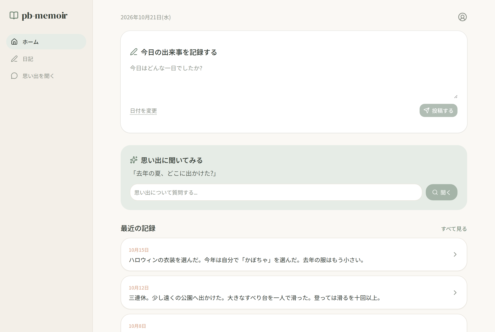
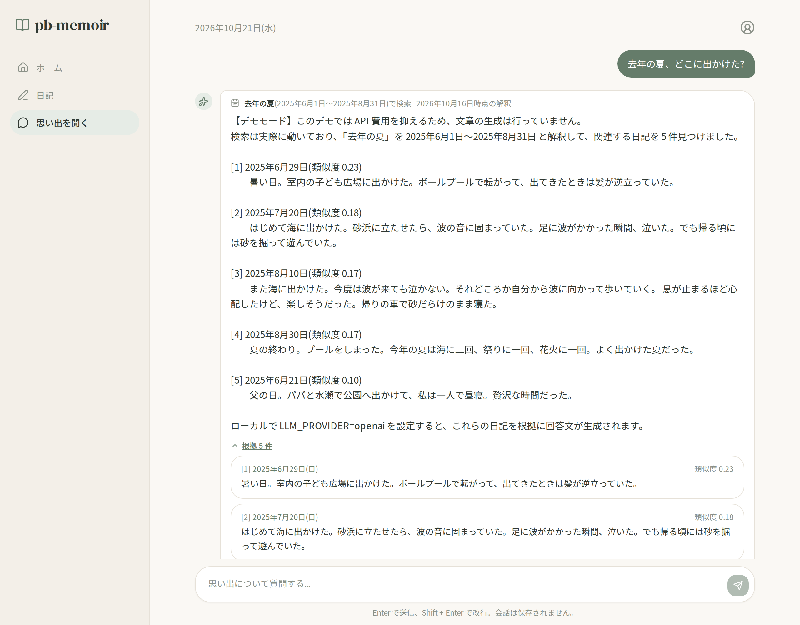
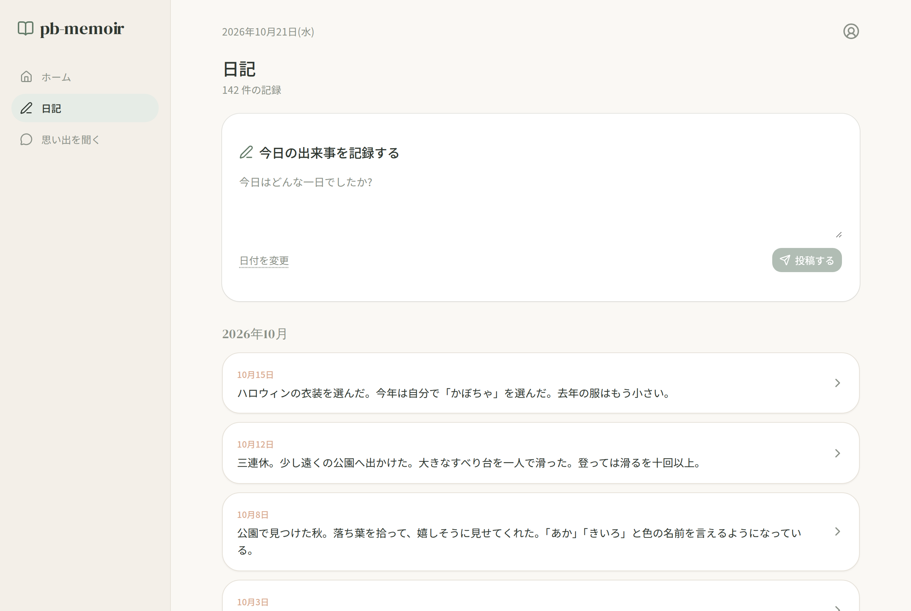
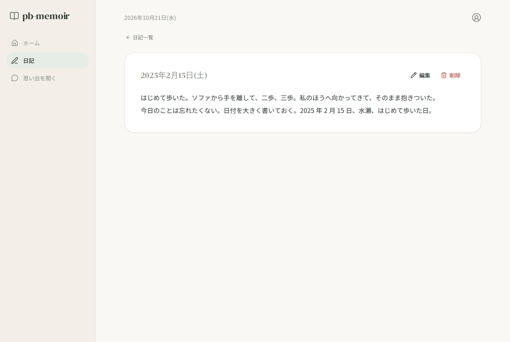
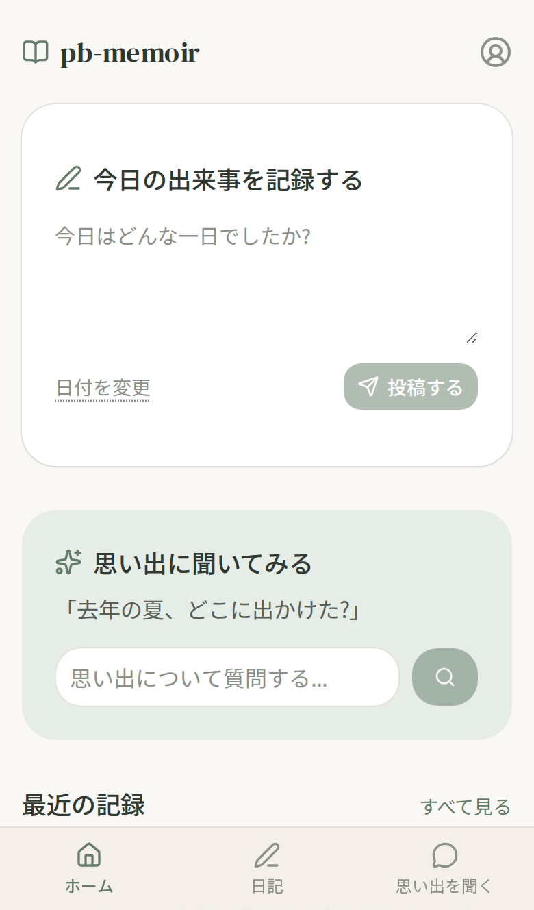
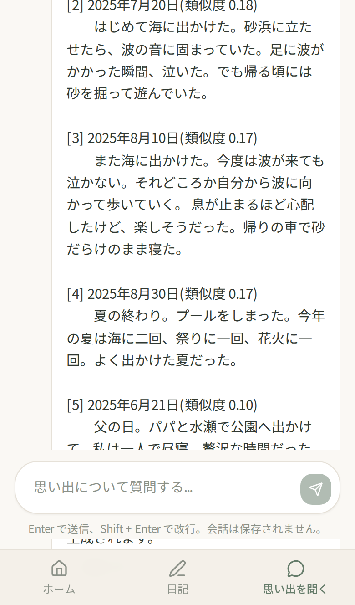
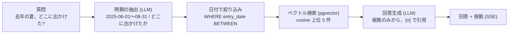
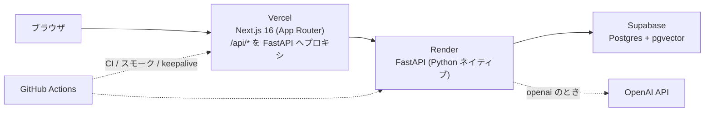

# pb-memoir

[](https://github.com/beginner-python/pb-memoir/actions/workflows/ci.yml)

日記・思い出・子育ての記録を書き溜めて、あとから自然文で聞ける個人ナレッジアプリ。
RAG(Retrieval-Augmented Generation)を外部フレームワークに頼らず自前で実装したポートフォリオ作品です。

> 「去年の夏、どこに出かけた?」と聞くと、**その期間の日記だけを根拠にして**答えます。

**公開デモ**: https://pb-memoir.vercel.app

- 架空の家族(両親と娘の水瀬)の日記 142 件が入っています。閲覧と質問ができ、書き込みはできません
- 初回アクセスは API サーバーの復帰に 30〜60 秒かかることがあります(無料枠のため)
- 費用ゼロで運用するため、公開デモでは LLM による文章生成を行っていません。検索と根拠の提示は実際に動き、回答は検索結果を引用する定型文です。ローカルで OpenAI のキーを設定すると全機能が動きます


| ホーム | 思い出を聞く |
|---|---|
|  |  |

| 日記一覧 | 日記の詳細 | スマホ(ホーム) | スマホ(チャット) |
|---|---|---|---|
|  |  |  |  |

## できること

- **書く**: 日付と本文だけの日記を、ホームからページ遷移なしで投稿。編集・削除
- **聞く**: 自然文で質問すると、LLM が「いつの話か」と「何についてか」に分解し、日付で絞り込んだうえでベクトル検索した日記を根拠に回答。回答はストリーミングで表示され、解釈した期間と根拠(日付・本文・類似度)を確認できる
- **切り替える**: `LLM_PROVIDER=openai` で OpenAI、`mock` で外部 API を一切呼ばないデモモード。UI と API は両モードで同一

## RAG の仕組み



| 要素 | 実装 | 一般的な呼び名 |
|---|---|---|
| 質問の構造化 | LLM の Structured Outputs で日付範囲と意味検索用の質問に分解。決定的な後処理で検証・補正 | Self-Query |
| 絞り込み | `entries.entry_date` 列で先に絞る。埋め込みには日付を含めない | Metadata Pre-filtering |
| 検索 | 本文のみを埋め込み、cosine 類似度の上位 5 件。0 件なら範囲を外して再検索 | Dense Retrieval |
| 生成 | 日付付きの根拠だけを渡し、根拠にない事は「記録がない」と答えさせる | Grounded Generation |

全体は「抽出 → 検索 → 生成」の固定 1 パス(Advanced RAG)で、Agentic なループは持ちません。
設計の詳細、採用しなかった手法、設計判断の記録は [docs/rag-design.md](docs/rag-design.md) にまとめています。

### デモモード(mock)の仕組み

| 役割 | openai(ローカル) | mock(公開デモ) |
|---|---|---|
| 埋め込み | `text-embedding-3-small` | 文字 2-gram / 3-gram を特徴ハッシュで 1536 次元に写す決定的ベクトル。語彙の重なりを cosine で拾える |
| 時期の抽出 | `gpt-4o-mini` + Structured Outputs | 質問例に対して、ローカルで実際に LLM に抽出させた結果を完全一致で再生(`app/data/suggestions.json`) |
| 回答 | `gpt-4o-mini` のストリーム | 検索結果を引用する定型文を疑似ストリーム |

モックは語彙の重なりしか見ないため、言い換え(「犬」と「ワンちゃん」)は拾えず、時期の抽出は質問例に対してのみ動きます。

## 構成



| 層 | 技術 |
|---|---|
| フロントエンド | Next.js 16 (App Router, Cache Components), TypeScript, Tailwind CSS v4, shadcn/ui |
| バックエンド | FastAPI, SQLAlchemy 2.0 (async), Alembic, Pydantic Settings |
| データベース | PostgreSQL + pgvector(HNSW)。ローカルは Docker、本番は Supabase |
| LLM / 埋め込み | OpenAI(`gpt-4o-mini`, `text-embedding-3-small`)。公開デモはモック |
| テスト | pytest(結合テストは専用 DB)、Vitest、Playwright(専用スタックの E2E、ステージングのスモーク) |
| 運用 | Docker Compose(開発)、Vercel + Render + Supabase(無料枠)、GitHub Actions |

ブラウザからの API 呼び出しは Next.js の Route Handler が FastAPI に転送します(バックエンドの URL を隠し、SSE もそのまま通す)。
会話履歴はブラウザ内だけに持ち、サーバーはステートレスです。

## 設計判断

| 判断 | 選択 | 理由 |
|---|---|---|
| 時期の理解 | ルールではなく LLM のみ(+ 決定的な後処理) | 現在の RAG の標準的な手法。表現の幅に強く、実装を二重にしない |
| 公開デモの LLM | 呼ばない(モック) | 費用ゼロ。検索パイプラインは本物のまま、生成だけを省く |
| 日付の扱い | 埋め込みに含めず、列でフィルタ | 埋め込みモデルは日付の違いに鈍い。構造化できる属性は SQL で厳密に絞る |
| チャンク | `entry_chunks` を分離 | 日記は通常 1 チャンクだが、長文とモデル切替に備える |
| 埋め込み失敗時 | 日記の保存ごとロールバック | 「保存できたのに検索できない」状態を作らない |
| 公開デモの書き込み | `READ_ONLY=true` で 403 | 荒らし防止。サンプルは架空データ |
| Supabase の REST | RLS を有効化(ポリシーなし) | anon キーで表を読み書きされない。アプリは Postgres に直接接続 |
| 画面遷移 | パス名ごとに作り直す | Next.js 16 は前のページを保持するため、入力欄と会話を明示的にリセット |

## ローカル起動(Docker)

ローカル開発環境は Docker Compose で完結します。

```bash
cp backend/.env.example backend/.env       # 必要なら OPENAI_API_KEY と LLM_PROVIDER=openai を設定
cp frontend/.env.example frontend/.env.local
docker compose up --build
docker compose exec backend uv run python -m scripts.seed   # サンプル日記 142 件を投入
```

- フロントエンド: http://localhost:3000
- API: http://localhost:8000 (`/health`, `/docs`)
- DB: `localhost:5434`(ホストから接続する場合)

## テスト

| 種類 | 対象 DB | 実行 |
|---|---|---|
| バックエンド pytest(62 件) | 専用 DB `memoir_test`(自動作成、テストごとに空にする) | `docker compose exec backend uv run pytest` |
| フロント Vitest(20 件) | なし(純粋ロジック) | `docker compose exec frontend npm test` |
| E2E Playwright(10 件) | 専用スタック(`db-e2e` / `backend-e2e` / `frontend-e2e`)。使い捨て DB にサンプル日記を投入した状態で実行し、開発用 DB には触れない | `docker compose --profile e2e run --rm e2e` |
| スモーク(4 件) | ステージング・本番(読み取り専用) | `main` への push 後に Actions が自動実行 |

```bash
docker compose exec backend uv run ruff check .
docker compose exec frontend npm run lint
docker compose exec frontend npm run typecheck
docker compose rm -sf db-e2e backend-e2e frontend-e2e       # E2E 用スタックの片付け
```

## LLM のモード切替

1. `backend/.env` で `LLM_PROVIDER=openai` と `OPENAI_API_KEY` を設定し、`docker compose restart backend`
2. `docker compose exec backend uv run python -m scripts.reindex` で全日記を再埋め込み。モックと OpenAI は別の埋め込みモデルで同じ列を使うため、切り替えのたびに必要(142 件で約 1 万トークン、1 円未満)
3. 戻すときは `LLM_PROVIDER=mock` にして再起動し、再度 `reindex`

質問例のキャッシュは `LLM_PROVIDER=openai` で `scripts.build_suggestions` を実行して再生成します(「去年」「先月」は生成日基準で固定されるため、公開前に実行)。

## デプロイと運用

| 環境 | 起点 | フロント | API | DB |
|---|---|---|---|---|
| プレビュー | PR ブランチ | PR ごとの URL | ステージングを共用 | ステージング |
| ステージング | `main` | `main` ブランチの固定 URL | `pb-memoir-staging`(Render) | `pb-memoir-staging`(Supabase) |
| 本番 | タグ `v*` → `release` | https://pb-memoir.vercel.app | `pb-memoir`(Render) | `pb-memoir`(Supabase) |

- PR → CI(backend / frontend / e2e)→ `main` にマージ → ステージングへ自動デプロイ → スモークテスト
- `git tag -a vX.Y.Z` を push すると、Release ワークフローが `main` の祖先であること・CI 成功を確認して `release` ブランチを進め、本番がデプロイされる
- 無料枠の休止対策として、Keepalive ワークフローが 3 日ごとに Render と Supabase を叩く
- 構成は `render.yaml`(Blueprint)、`frontend/vercel.json`、`.github/workflows/` にコードとして置き、手順は [docs/deploy.md](docs/deploy.md) にまとめている

## 今後の候補

- 振り返りの自動生成(「この 1 か月のまとめ」)、カレンダー表示、写真の添付、ログイン認証(Supabase Auth)
- ハイブリッド検索(全文検索との併用)とリランク、検索品質の評価スクリプト
- E2E の本番ビルド化、レート制限

## 開発の進め方

目的・テーマ・MVP・スタック・運用方針・設計・実装計画・見せ方を順に決めてから、フェーズごとに「設計 → レビュー → 実装 → 検証」で進めました。
各フェーズの設計と判断は [docs/rag-design.md](docs/rag-design.md) と [docs/deploy.md](docs/deploy.md) に残しています。
