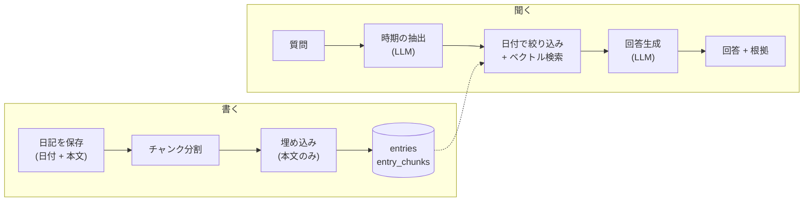
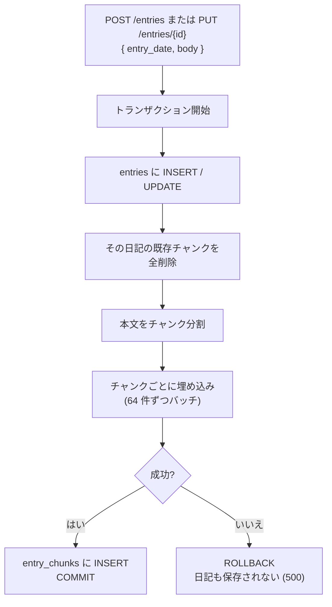
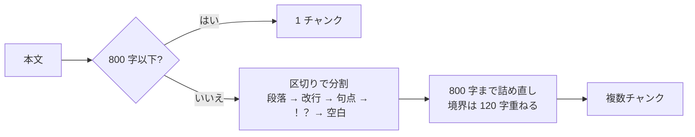
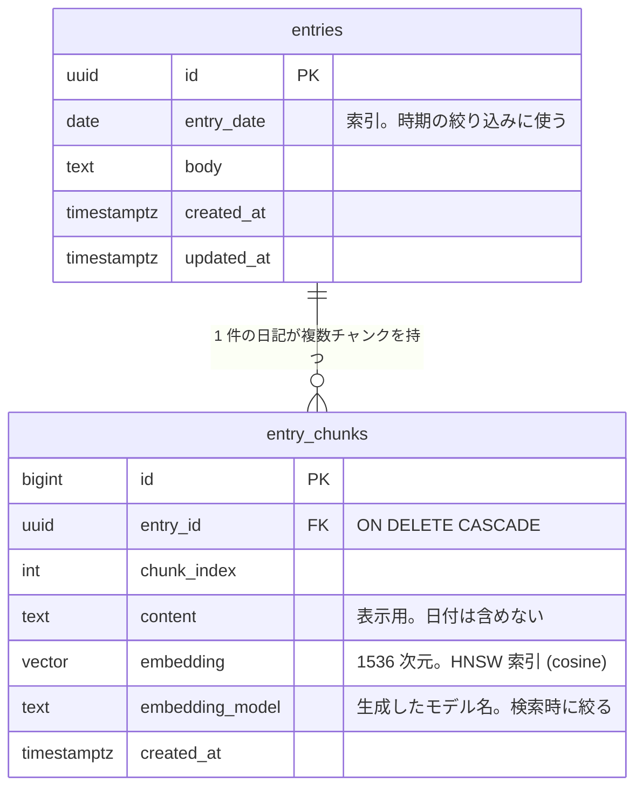
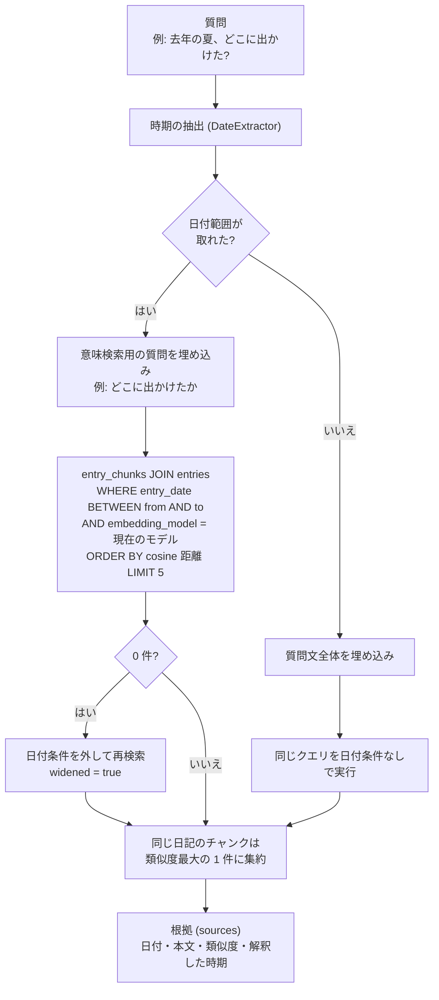
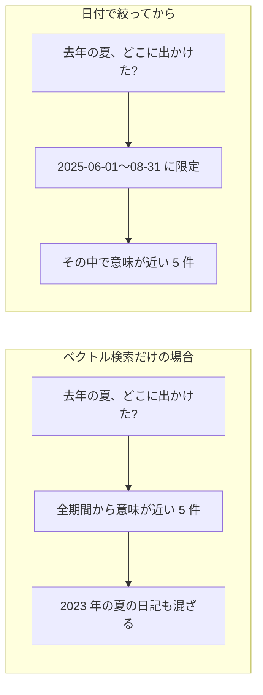
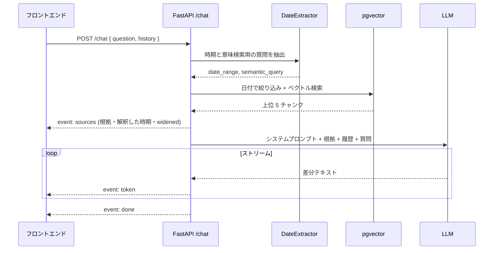
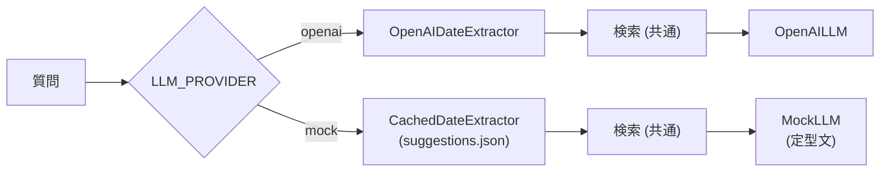

# pb-memoir の RAG 設計

日記を書き溜めて、あとから自然文で聞ける個人ナレッジアプリの、RAG(Retrieval-Augmented Generation)に関する設計をまとめたものです。
対象は **文書登録(取り込み)**、**検索**、**回答生成** の 3 つです。

| 区分 | 状態 |
|---|---|
| 文書登録 | フェーズ 1 で実装済み |
| 検索・回答生成 | フェーズ 2 で実装済み |

---

## 1. 全体像

ユーザーの操作は「書く」と「聞く」の 2 つです。書いた日記はその場で検索可能な形に変換され、聞いたときは日付とベクトルの 2 段階で絞ってから回答が生成されます。



設計の軸は次の 3 点です。

1. **埋め込みは本文の意味だけ、日付は構造化された列で持つ**。時期の絞り込みは SQL の `WHERE` で厳密に行い、ベクトルは「何について書いたか」の近さだけに使う
2. **LLM は 2 回呼ぶ**。1 回目は質問を構造化(時期 + 意味検索用の質問)、2 回目は根拠から回答を生成
3. **公開デモでは LLM を呼ばない**。検索は実際に動かし、LLM の役割はキャッシュ再生と定型文で代替する

---

## 2. 文書登録(取り込み)

### 流れ



- 日記の保存とチャンクの作成を **同じトランザクション** で行います。「保存はできたが検索できない」という中間状態を作らないための判断です
- 更新時は差分を取らず **全チャンクを作り直し** ます。日記 1 件は短く、作り直しのコストは無視できるためです

### チャンク分割

区切りを大きいものから順に試す再帰分割です。既定は 800 文字、チャンク境界では前チャンク末尾 120 文字を次チャンク先頭に重ねます。



日記は 1 件が数百文字なので、ほとんどが 1 チャンクになります。`entry_chunks` を分離しているのは、長文への対応と、埋め込みモデルを切り替えたときに本文を触らずチャンクだけ作り直せるようにするためです。

### 埋め込み対象

**本文のみ** を埋め込みます。日付をチャンクの先頭に前置する手法(コンテキスト付きチャンク)もありますが、採用していません。

| 方式 | 採否 | 理由 |
|---|---|---|
| 本文のみ埋め込み + 日付は列でフィルタ | 採用 | 埋め込みは意味、列は構造、と責務が分かれる。日付だけの変更で再埋め込みが不要 |
| 日付を前置して埋め込み | 不採用 | 埋め込みモデルは数字や日付の違いに鈍く、効果が弱い。時期は SQL で厳密に絞れる |

### データモデル



`embedding_model` 列は、OpenAI とモックのベクトル(空間が異なり比較できない)を混ぜないためのものです。検索時は現在のプロバイダと同じモデルで作られたチャンクだけを対象にします。

---

## 3. 検索

### 流れ



### 時期の抽出

質問から「いつの話か」と「何の話か」を分けます。**LLM のみ** で行い、ルールベースの日付解析は持ちません。

```json
// LLM に Structured Outputs で返させるスキーマ
{
  "date_from": "2025-06-01",
  "date_to": "2025-08-31",
  "label": "去年の夏(2025年6月〜8月)",
  "semantic_query": "どこに出かけたか"
}
```

LLM の出力には決定的な後処理をかけます。

| 後処理 | 内容 |
|---|---|
| 形式検証 | 日付として読めなければ時期なし扱い |
| 入れ替え | `from > to` なら交換 |
| 未来の丸め | `to` が今日より未来なら今日に |
| 単日化 | どちらか一方だけなら同日を範囲に |
| 空の補完 | `semantic_query` が空なら元の質問を使う |

年齢表現(「3 歳のころ」)は誕生日を知らないため、LLM に null を返すよう指示します。

### なぜ日付を先に絞るのか



埋め込みは「夏」「出かけた」という意味は捉えますが、「去年」と「一昨年」を区別できません。時期は構造化された列で厳密に絞り、意味の近さはベクトルに任せる、という分担です。この方式は **メタデータの事前フィルタリング** と呼ばれ、pgvector を含むほとんどのベクトル DB が標準で備えています。

---

## 4. 回答生成

### 流れ(SSE)

根拠は生成を待たずに最初に送るため、画面では「どの日記を見ているか」が先に表示され、その後に回答が流れてきます。



### プロンプトの構造

```
[system]
あなたは個人の日記を根拠に答えるアシスタントです。
- 回答は「参考資料」に含まれる内容のみを根拠にしてください
- 資料に無いことは「日記にはその記録がありません」と答えてください
- 根拠にした日記は文末に [1] [2] のように番号で示してください
- 日本語で簡潔に答えてください

[user]
# 参考資料
[1] 2025年8月10日
家族で海に行った。息子が初めて波に触れて…

[2] 2025年7月20日
…

# 質問
去年の夏、どこに出かけた?
```

- 会話履歴(`history`)は回答生成にだけ渡し、検索には使いません(MVP の制約)
- 根拠に日付を付けて渡すので、「はじめて歩いたのはいつ?」のような質問にも日付で答えられます

---

## 5. モードによる差分

環境変数 `LLM_PROVIDER` で切り替えます。**UI と API の形は両モードで同一** で、差はプロバイダ層の実装だけです。

| 役割 | openai(ローカル) | mock(公開デモ) |
|---|---|---|
| 埋め込み | `text-embedding-3-small` 1536 次元 | 文字 3-gram と単語を特徴ハッシュで 1536 次元に写す決定的ベクトル。語彙の重なりを cosine で拾える |
| 時期の抽出 | `gpt-4o-mini` + Structured Outputs | **LLM 出力のキャッシュ**。質問例(`suggestions.json`)にローカルで抽出した結果を保存し、質問文が一致すれば再生。不一致なら時期なし |
| 回答生成 | `gpt-4o-mini` ストリーム | 定型文。解釈した時期、見つかった日記の日付・抜粋・類似度を並べ、「ローカルで OpenAI を設定すると回答文が生成される」旨を添える |
| 検索(SQL) | 共通 | 共通 |
| 費用 | 従量 | ゼロ |



モックの限界は README にも明記します。

- 意味的な類似(「犬」と「ワンちゃん」)は拾えない
- 時期の理解は質問例に対してのみ動く。相対表現(「去年」)はキャッシュ生成時の基準日で固定されるため、`as_of`(基準日)を一緒に返して表示する

---

## 6. 採用した手法の位置づけ

| 要素 | 採用した手法 | 一般的な呼び名 |
|---|---|---|
| 質問の構造化 | LLM で日付範囲と意味検索用の質問に分解 | Self-Query / Query Structuring |
| 絞り込み | `entry_date` 列で先に絞る | Metadata Pre-filtering |
| 検索 | cosine 類似度の上位 k 件(k=5) | Dense Retrieval |
| 救済 | 0 件なら範囲を外して再検索 | 固定のフォールバック |
| 生成 | 日付付き根拠のみから回答、[n] で引用 | Grounded Generation with Citations |
| 全体 | 抽出 → 検索 → 生成 の固定 1 パス | **Advanced RAG**(Agentic RAG ではない) |

Agentic RAG との違い: 本システムでは「0 件なら範囲を広げる」などの判断をコードに固定しています。LLM 自身が結果を評価し、条件を変えて再検索するループを持つなら Agentic RAG になります。

### 意図的に採用していないもの(将来の候補)

| 手法 | 見送った理由 |
|---|---|
| ルールベースの日付解析 | LLM のみで一本化し、実装を二重にしない |
| ハイブリッド検索(全文検索との併用) | 固有語の取りこぼしは日記の規模では限定的。フェーズ 6 の候補 |
| リランク | 上位 5 件を LLM に渡す規模では効果が小さい |
| 会話履歴による質問の書き換え | MVP では履歴を生成にのみ使う |
| Agentic な再検索ループ | 公開デモでは LLM を呼べず見せられない |
| セマンティックキャッシュ(あいまい一致) | あいまい一致を入れるとルールベースに近づく。完全一致のみ |

---

## 7. 設計判断の記録

| 判断 | 選択 | 理由 |
|---|---|---|
| チャンクを別テーブルにするか | 分離(`entry_chunks`) | 長文対応とモデル切替の拡張性。日記では通常 1 件 1 チャンク |
| 埋め込み失敗時 | 日記の保存ごとロールバック | 「保存されたのに検索できない」状態を作らない。再試行ジョブは MVP に重い |
| 日付の前置埋め込み | しない | 日付は列でフィルタ。埋め込みは本文の意味に専念 |
| 時期抽出の方式 | LLM のみ + 決定的な後処理 | 現在の RAG の標準。表現の幅に強い。ルールとの二重管理を避ける |
| 公開デモでの時期抽出 | LLM 出力の完全一致キャッシュ | 費用ゼロと UI 不変を両立。再生する内容は本物の LLM 出力 |
| モック専用の UI | 作らない | UI は両モードで同一。差はプロバイダ層に閉じる |
| 類似度のしきい値 | 設けない | モデルによって分布が異なり、モックでは全体に低く出る。表示用に 0〜1 に丸めるのみ |
| 0 件時のフォールバック | 日付条件を外す(件数が少ないだけなら外さない) | 1〜2 件のときに範囲外を混ぜると、意図した時期と違う日記が根拠に入る |
